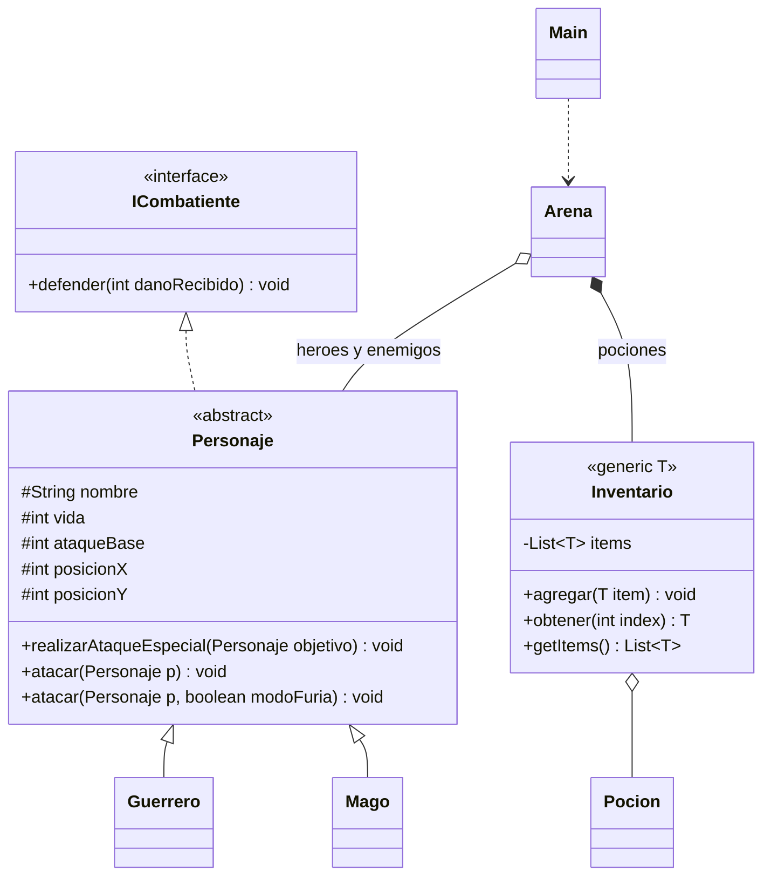

# Arena RPG — Taller de POO, Colecciones y Genéricos

Proyecto: **ArenaRPG**. Nombre propuesto del repositorio: **taller-07-arena-rpg**.
Juego educativo de consola en Java 21, sin dependencias externas. No se ha publicado un repositorio en GitHub.

## Requisitos y diseño

El taller solicita una interfaz, una clase abstracta, herencia, constructores con super,
sobreescritura, sobrecarga, polimorfismo, listas dinámicas, inventario genérico,
matriz 5×5, turnos con do-while/Scanner/switch y depuración en IntelliJ.



## Estructura

```text
ArenaRPG/
  pom.xml
  README.md
  PRUEBAS.md
  DEPURACION.md
  src/main/java/org/example/
    Main.java          Inicio y Scanner
    ICombatiente.java  Contrato de defensa
    Personaje.java     Estado y comportamiento compartidos
    Guerrero.java      Escudo y ataque de furia
    Mago.java          Mana y hechizo
    Inventario.java    Contenedor generico Inventario<T>
    Pocion.java        Curacion
    Arena.java         Listas, tablero, turnos y condiciones finales
  src/test/java/org/example/PruebasArena.java
```

## Decisiones sobre ambigüedades

- La victoria requiere **ambas** condiciones: eliminar a todos los enemigos y que Thorin llegue al cofre (2,2). El do-while continúa mientras no haya victoria ni derrota; así se permite explorar después de eliminar enemigos. Llegar antes al cofre no basta.
- Thorin es el héroe principal. Su muerte causa derrota adicional, aunque Gandalf siga vivo; evita una misión sin posibilidad de victoria. También se comprueban vida total cero y lista de héroes vacía.
- Las listas se limpian al final de ronda con removeIf. Para decidir la victoria inmediatamente después de un ataque se comprueba que no queden enemigos vivos, aunque los caídos aún estén en la lista.
- X es columna y Y es fila: se accede a tablero[y][x]. El movimiento permite una casilla ortogonal por turno. Las casillas ocupadas por personajes vivos no se pueden atravesar.
- No hay alcance de ataque, pues el PDF no especifica distancias. El daño es individual, acorde con la firma que recibe un objetivo. No se agrega daño de área.
- El cofre permanece en (2,2); un personaje lo oculta mientras lo ocupa y vuelve a mostrarse si sale. Los caídos desaparecen del mapa al actualizarlo.
- Una entrada inválida no consume turno. Cada ataque válido, movimiento válido o poción utilizada consume la acción. Al acabarse la entrada se interrumpe la partida sin inventar un resultado.

## Reglas y valores elegidos

Son decisiones de implementación cuando el PDF no fija valores:

| Elemento | Regla |
|---|---|
| Thorin | 120 vida, 15 ataque, escudo 10, posición (0,0) |
| Gandalf | 80 vida, 25 ataque, 50 mana, posición (1,1) |
| Orco | Guerrero: 60 vida, 16 ataque, escudo 3, posición (4,0) |
| Brujo | Mago: 45 vida, 12 ataque, 20 mana, posición (0,4) |
| Guardián | Guerrero: 70 vida, 18 ataque, escudo 5, posición (4,4) |
| Ataque normal | ataqueBase; se utiliza mediante atacar(p) |
| Furia del guerrero | ataqueBase × 2 mediante atacar(p, true), sin coste adicional |
| Defensa del guerrero | resta fuerzaEscudo al daño, con mínimo cero |
| Defensa del mago | recibe todo el daño |
| Hechizo | ataqueBase + 10; cuesta 10 mana |
| Mana insuficiente | usa ataque normal sin gastar mana ni bajar de cero |
| Pociones | 35, 35 y 50 de curación, se consume la primera disponible |
| Curación | no resucita ni supera la vida inicial; usarla con vida completa también la consume |
| Enemigos | cada enemigo vivo usa su especial contra el primer héroe vivo |

## Conceptos aplicados

| Concepto | Dónde estudiarlo |
|---|---|
| Interfaz y abstracción | ICombatiente y Personaje |
| Herencia y super | constructores de Guerrero y Mago |
| Sobreescritura | realizarAtaqueEspecial, defender y getEstado con @Override |
| Sobrecarga | dos firmas de atacar en Personaje; furia y ataque sin mana las ejecutan |
| Polimorfismo | referencias Personaje en turnos de héroes y enemigos |
| Colecciones | List<Personaje>, ArrayList, add/get/size/removeIf en Arena |
| Genéricos | Inventario<T>, List<T> e Inventario<Pocion>, sin raw types ni casteos |
| Matriz y bucles anidados | actualizarTablero y mostrarTablero |
| Control de flujo | do-while en jugar, switch en turnoHeroe y for-each en turnos |
| Validaciones | leerEntero, mover, usarPocion y comprobación de objetivos |

## Abrir y ejecutar en IntelliJ IDEA

1. Abre la carpeta ArenaRPG o su pom.xml y carga el proyecto Maven.
2. En File > Project Structure selecciona un JDK 21. El pom.xml ya pide Java 21.
3. Abre src/main/java/org/example/Main.java y ejecuta su método main con el botón verde.
4. Introduce números en la consola: 1 para ataque y selección de enemigo, 2 para poción, 3 para movimiento introduciendo columna X y fila Y por separado.
5. Las coordenadas van de 0 a 4. El turno enemigo es automático.

## Compilar y comprobar sin dependencias

Desde la carpeta del proyecto, en PowerShell, con JDK 21 disponible en PATH:

```powershell
New-Item -ItemType Directory -Force target/classes | Out-Null
$fuentesArena = Get-ChildItem src/main/java -Recurse -Filter *.java
javac -encoding UTF-8 -d target/classes $fuentesArena.FullName
java -cp target/classes org.example.Main
New-Item -ItemType Directory -Force target/test-classes | Out-Null
javac -encoding UTF-8 -cp target/classes -d target/test-classes src/test/java/org/example/PruebasArena.java
java -cp 'target/classes;target/test-classes' org.example.PruebasArena
```

PruebasArena es un ejecutable de comprobaciones sin JUnit: se ejecuta con su main, también desde IntelliJ. No se afirma que Maven lo ejecute automáticamente. Consulta PRUEBAS.md y DEPURACION.md.
